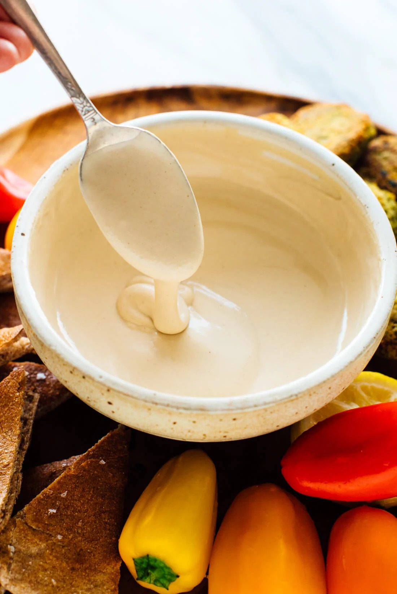

# Tahini Sauce

## Ingredients
- 4 medium-to-large cloves garlic, pressed or minced
- 1/4 cup lemon juice
- 1/2 cup tahini
- 1/2 teaspoon fine sea salt
- Pinch of ground cumin
- 6 tablespoons ice water, more as needed

## Preparation
1. In a medium bowl, combine the garlic and lemon juice. Let the mixture rest for 10 minutes, to give the garlic time to infuse the lemon juice with flavor.

2. Pour the mixture through a fine-mesh sieve into another medium bowl. Press the garlic solids with a spatula to extract as much liquid as possible. Discard the garlic.

3. Add the tahini, salt and cumin to the bowl. Whisk until the mixture is thoroughly blended.

4. Add water 2 tablespoons at a time, whisking after each addition until smooth. (It may seize up, don’t worry.) After about 6 tablespoons, you will have a perfectly creamy and smooth, light-colored tahini sauce.

5. If desired, thin with additional water for a more drizzly sauce. Adjust if necessary—if you’d like more tang, add more lemon, or for more overall flavor, add another pinch of salt. Your tahini sauce is ready to serve!