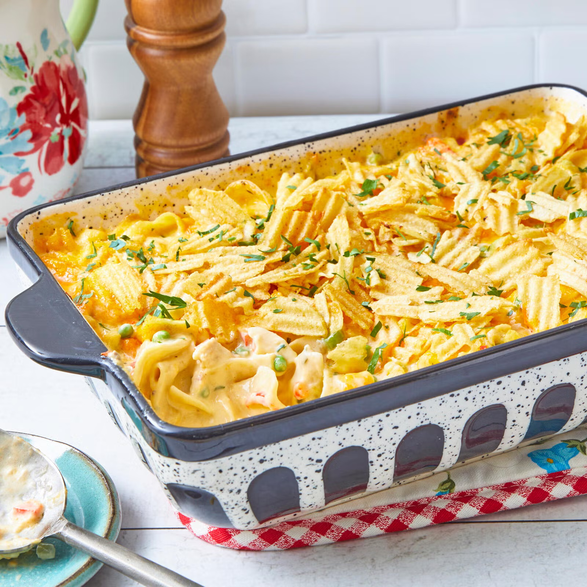

# Tuna Noodle Casserole

## Ingredients
- 12 oz. wide egg noodles
- 1 1/2 12-oz. can solid white tuna in water, drained
- 1 10.5-oz. can cream of mushroom soup
- 1 cup sour cream
- 1 1/2 cups heavy cream
- 1 cup frozen sweet peas
- 1 cup corn kernels
- 1 cup mushrooms, chopped
- 1 red bell pepper, chopped
- 1 celery stalk, chopped
- 1/2 cup finely chopped onion
- 2 cups shredded cheddar cheese, divided
- Salt, to taste
- Black pepper, to taste
- 2 cups crushed potato chips (ripple chips work best)

## Preparation
1. Preheat the oven to 375 degrees. Bring a large pot of salted water to a boil over high heat. Add noodles and cook 2 minutes less than the package directions. Drain and rinse under cool water. Set aside.

2. Stir together the tuna, cream of mushroom soup, sour cream, heavy cream, peas, corn, mushrooms, bell pepper, celery, onion, 1 cup of the cheese and salt and pepper to taste in a large bowl until combined. Stir in the cooked noodles and spoon the mixture into a lightly greased 13-by-9-inch baking dish.

3. Top the casserole with the remaining 1 cup of cheese, then the potato chips. 

4. Bake the casserole 25 to 30 minutes or until golden brown and bubbly around the edges.