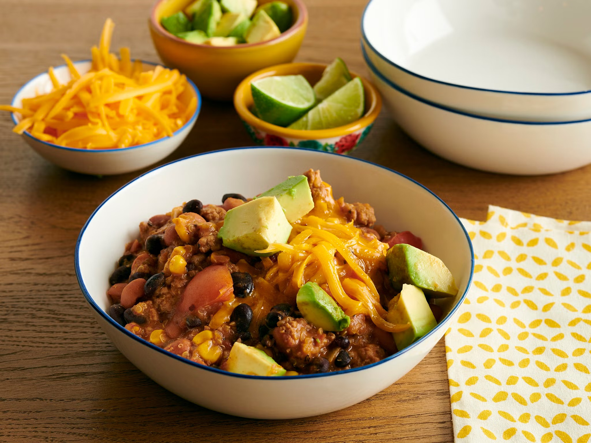

# Turkey Quinoa Chili

## Ingredients
- 2 Tbsp. vegetable oil 
- 1 red bell pepper, diced 
- 1 onion, diced 
- 1 lb. ground turkey 
- 1 1/2 tsp. kosher salt, plus more to taste 
- 2 garlic cloves, minced 
- 2 tsp. chili powder 
- 1 tsp. ground cumin 
- 2 1/2 cups low-sodium chicken broth 
- 1 canned chipotle chile in adobo sauce, minced (about 1 tablespoon) 
- 1 (15-ounce) can black beans, drained and rinsed 
- 1 (15-ounce) can pinto beans, drained and rinsed 
- 1 (14-ounce) can fire-roasted diced tomatoes 
- 1/2 cup frozen corn kernels 
- 1/3 cup quinoa, rinsed 
- Juice of 1 lime, plus wedges for serving 
- Shredded cheddar cheese and diced avocado, for topping 

Serve with bread (like a fresh baguette).

## Preparation
1. Heat the vegetable oil in a large pot or Dutch oven over medium-high heat. Add the bell pepper and onion and cook until beginning to soften, about 3 minutes. 

2. Add the turkey and 1/2 teaspoon salt and cook, breaking up the meat with a wooden spoon, until no longer pink, 4 to 5 minutes. Add the garlic, chili powder, cumin and remaining 1 teaspoon salt and cook until fragrant, about 30 seconds. 

3. Add the chicken broth, chipotle, black beans, pinto beans, tomatoes, corn and quinoa to the pot and stir to combine.

4. Bring the chili to a boil, then reduce to a simmer, cover and cook until the quinoa is tender, about 20 minutes. Squeeze in the lime juice and season with salt to taste. Serve topped with cheese and avocado, with lime wedges on the side. 